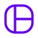
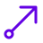

<picture>
  <source media="(prefers-color-scheme: dark)" srcset="assets/banner-dark.svg">
  
</picture>

<p align="center">
  <a href="https://rakibshekh.xyz"></a>
  <a href="https://www.linkedin.com/in/mdrakib-shekh/"></a>
  <a href="https://behance.net/rakibshekh"></a>
  <a href="https://dribbble.com/rakibshekh"></a>
  <a href="https://x.com/mdrakibshekh"></a>
  <a href="https://www.instagram.com/mdrakib_shekh"></a>
</p>

## 👋 Hi, I'm Rakib

I design SaaS products and design systems, then build the tools I wish I had.
Alongside client work I make **UIX**: a growing family of open-source and paid tools that take a design from Figma to production code without losing the details on the way.

- 🎨 **Senior UX & Product Designer**, specialising in SaaS, MVPs, AI web apps and design systems
- 🏢 **Founder of [Sigma Studio](https://rakibshekh.xyz)**, a boutique design studio, and **Led UX Designer at EzyOne GmbH**
- 🌍 Based in **Dhaka, Bangladesh**, working remotely with teams worldwide
- ⚙️ I ship code too: React, Tailwind, Figma and Framer plugins, Cloudflare Workers

<p align="center">
  <a href="https://calendly.com/rakibshekh/project-discussion"></a>
  <a href="https://drive.google.com/file/d/1IBPRvtiy_KsxdNVg1ebBHO9LJpC9j0x5/view?usp=sharing"></a>
</p>

---

## 🚀 What I'm building

| | Product | What it does |
|:--:|:--|:--|
|  | **[UIX Icons](https://uixicons.com)** | **23,000+ original icons** in 15 styles on one 24 px grid. Three styles are free under MIT, with SVG, React, an icon font, a CLI and an MCP server for AI assistants. Pro adds the other twelve. [Open source →](https://github.com/mdrakibshekh/uix-icons) |
|  | **[uix-ui](https://uixdesign.pagestro.com/ui)** | 64 accessible React components and 42 Tailwind CSS v4 themes that start in your brand. Copy them into your project and own the code. MIT. [Open source →](https://github.com/mdrakibshekh/uix-ui) |
|  | **[UIX Design System Generator](https://uixdesign.pagestro.com)** | A Figma plugin that turns one brand colour into variables, styles, 74 components and matching code. |
|  | **[UIXport](https://uixport.pagestro.com)** | A Figma plugin that exports PNG, JPG, WebP, AVIF, SVG and merged PDFs in one run. |
|  | **[Pagestro](https://pagestro.com)** | PDF tools, e-signatures, invoices, QR codes and an email builder in one browser workspace. |

### ⚡ Try it in ten seconds

```bash
# open-source React components and a theme that matches your brand
npx uix-ui@latest init --preset lagoon-stretch
npx uix-ui@latest add button card input

# 23,000+ icons as React components
npm install @uixicons/react

# or pull any icon straight into your project from the terminal
npx @uixicons/cli add solid bell home search --format react
```

---

## 🧰 Tools I work with

<p>
  
  
  
  
  
  
  
  
  
</p>

---

## 🤝 Work with me

I take on a few projects at a time for founders and product teams:

- **UX/UI design** for web apps and marketing sites
- **SaaS product design**, from the first flow to a launch-ready system
- **MVP design** that engineers can build from
- **AI web-app design** and design systems that your team and your AI tools can both read

<a href="https://rakibshekh.xyz/work"></a>

## ✍️ Latest writing

- [A full design system in Figma, without burning tokens](https://rakibshekh.xyz/blog/design-system-figma-without-burning-tokens) (Oct 2026): build an enterprise-level design system once, with rule files your AI builder reads, instead of re-explaining it in every chat.

---

<p align="center">
  <sub>Made with care in Dhaka · the icons on the banner are from <a href="https://uixicons.com">UIX Icons</a> (Regular Rounded, MIT)</sub>
</p>
